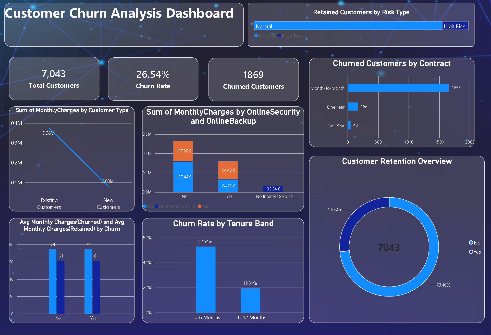

Customer Churn Analysis – Power BI

Project Overview

This project analyzes customer churn to understand customer retention and identify patterns associated with customer cancellations.

Tools Used

- Microsoft Power BI
- Power Query
- DAX (if used)

Key Metrics

- Total Customers: 7,043
- Churn Rate: 26.54%
- Churned Customers: 1,869

Dashboard Features

- Customer retention overview
- Churn rate analysis
- Contract-wise churn analysis
- Monthly charges analysis
- Tenure band analysis

Objective

To analyze customer behavior and provide insights that can help businesses improve customer retention.
## Dashboard Preview

